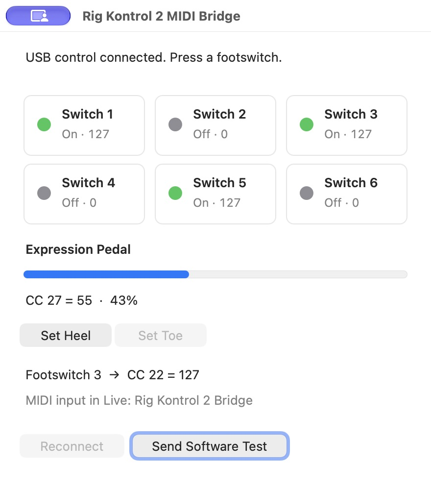

# Rig Kontrol 2 Bridge

Use the Native Instruments Rig Kontrol 2 as a USB MIDI controller on an Apple Silicon Mac. The bridge turns its footswitches and expression pedal into a virtual MIDI input named **Rig Kontrol 2 Bridge**.

**MIDI control only.** Audio over USB is excluded. The bridge provides no Core Audio inputs or outputs for recording through the Rig Kontrol 2’s guitar inputs or playing back and monitoring through its outputs. Connect your guitar and headphones or speakers to a separate audio interface, then select that interface in your digital audio workstation (DAW).

All six footswitches and the expression pedal were tested successfully and mapped to MIDI-controllable parameters in Ableton Live.

The bridge is expected to work with other DAWs on Apple Silicon Macs that accept virtual MIDI input and support MIDI mapping. Testing to date has been limited to Ableton Live.



## Install and connect

The app targets macOS 13 or later on Apple Silicon.

1. Download `Rig-Kontrol-2-Bridge-0.1-macOS-arm64.zip` from the release assets. Verify the ZIP before unzipping it.
2. Unzip the download and open **Rig Kontrol 2 Bridge.app**. You can keep the app in **Applications**.
3. Plug in the Rig Kontrol 2 over USB. If you plugged it in after opening the app, click **Reconnect**. Leave the bridge open while using the controller. [Apple’s guide to approving USB accessories](https://support.apple.com/en-us/102282)

The app is signed with Developer ID and notarized by Apple. The app bundle includes the notarization ticket.

### Verify the download

Download `SHA256SUMS.txt` from the same release and place it beside the app ZIP. Open Terminal in that folder and run:

```sh
shasum -a 256 -c SHA256SUMS.txt
```

Look for `Rig-Kontrol-2-Bridge-0.1-macOS-arm64.zip: OK`. If the check fails, discard the ZIP and download it again from the official release. The checksum verifies that the ZIP matches the published file. For publisher identity, use the project’s official release page.

## Map controls in Ableton Live

1. Go to **Settings → Link, Tempo & MIDI**. Under **MIDI Ports**, enable **Remote** for the **Rig Kontrol 2 Bridge** input.
2. Choose **Options → Edit MIDI Map** (**Command-M**) and click the control you want to assign.
3. Press a footswitch or move the expression pedal to make the mapping.
4. Press **Command-M** again to exit MIDI Map Mode, then save the Live Set.

[Ableton Live Reference Manual](https://www.ableton.com/en/live-manual/12/midi-and-key-remote-control/)

## Footswitches and expression pedal

- **Switches 1–6** send CC 20–25 on MIDI channel 1. Each press alternates between 0 (off) and 127 (on). Each physical LED mirrors its indicator in the bridge window.
- **The expression pedal** sends CC 27 on MIDI channel 1 over a 0–127 range. To calibrate it, rock the pedal fully back and click **Set Heel**. Move it fully forward without pressing through the toe switch and click **Set Toe**. Calibration is saved on your Mac.

## Build from source

Install Apple’s Xcode Command Line Tools with `xcode-select --install`. Open Terminal in the source folder and run:

```sh
sh ./build-app.sh
```

The script builds **Rig Kontrol 2 Bridge.app** in the source folder for local testing.

## Credits and development references

- The Linux **snd-usb-caiaq** driver documents the Rig Kontrol 2 USB protocol. [USB IDs](https://github.com/torvalds/linux/blob/master/sound/usb/caiaq/device.h) · [USB commands](https://github.com/torvalds/linux/blob/master/sound/usb/caiaq/device.c) · [Switch and pedal reports](https://github.com/torvalds/linux/blob/master/sound/usb/caiaq/input.c) · [LED bit positions](https://github.com/torvalds/linux/blob/master/sound/usb/caiaq/control.c)
- **rk2-modep-control** is a related Linux project for using the Rig Kontrol 2 switches and pedals as MIDI controllers. [aFunkyBass’s project](https://github.com/aFunkyBass/rk2-modep-control)
- Apple’s framework documentation covers USB transfers, virtual MIDI sources, and the macOS interface. [IOUSBHost](https://developer.apple.com/documentation/iousbhost/iousbhostpipe) · [Core MIDI source](https://developer.apple.com/documentation/coremidi/midisourcecreatewithprotocol) · [Core MIDI event delivery](https://developer.apple.com/documentation/coremidi/midireceivedeventlist) · [AppKit](https://developer.apple.com/documentation/appkit)

## License

The bridge’s original code is available under the MIT License. The repository, app bundle, and app ZIP each include the license text. [LICENSE](LICENSE)
